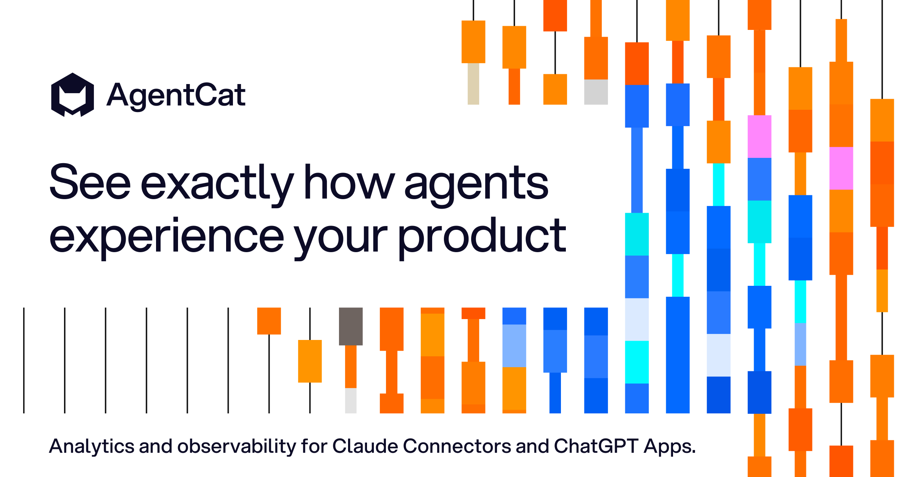
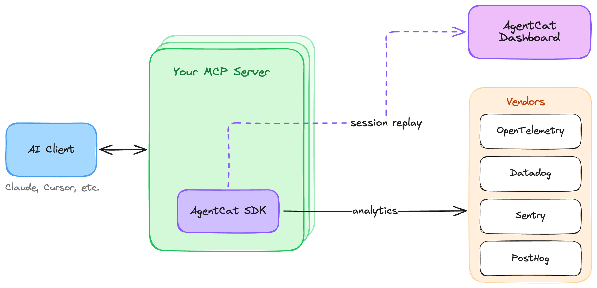
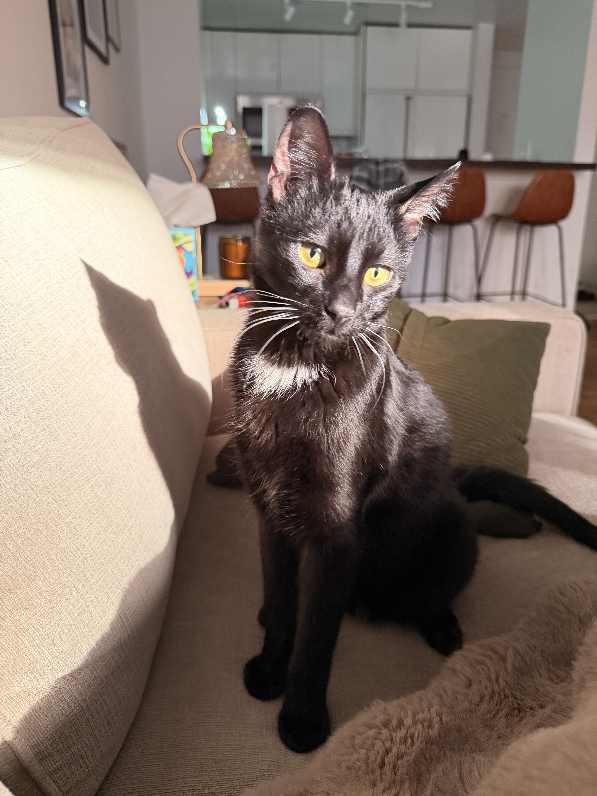

<div align="center">
  
</div>
<h3 align="center">
    <a href="#getting-started">Getting Started</a>
    <span> · </span>
    <a href="#why-use-agentcat-">Features</a>
    <span> · </span>
    <a href="https://docs.agentcat.com">Docs</a>
    <span> · </span>
    <a href="https://agentcat.com">Website</a>
    <span> · </span>
    <a href="#free-for-open-source">Open Source</a>
    <span> · </span>
    <a href="https://meet.agentcat.com/meet">Schedule a Demo</a>
</h3>
<p align="center">
  <a href="https://crates.io/crates/agentcat-sdk"></a>
  <a href="https://crates.io/crates/agentcat-sdk"></a>
  <a href="https://docs.rs/agentcat-sdk"></a>
  <a href="https://opensource.org/licenses/MIT"></a>
  <a href="https://www.rust-lang.org/"></a>
  <a href="https://github.com/agentcathq/agentcat-rust-sdk/issues"></a>
  <a href="https://github.com/agentcathq/agentcat-rust-sdk/actions"></a>
</p>

> [!NOTE]
> AgentCat v2 introduces compatibility with the [MCP Protocol "Stateless" 2026-07-28 Update](https://blog.modelcontextprotocol.io/posts/2026-07-28/) and the coinciding [rmcp 3](https://github.com/modelcontextprotocol/rust-sdk) release that puts it into effect. The stateless transition has a massive impact on analytics, as sessions were a built-in concept tying related tool calls together. AgentCat has now migrated its session tracking under guidance of the MCP core team's recommendations of using [explicit handles (SEP-2567)](https://github.com/modelcontextprotocol/modelcontextprotocol/pull/2567).
>
> As a result AgentCat now injects a `session_id` on every MCP tool call to associate them under the same task umbrella. Our evals show much higher tool correlation accuracy at the cost of < 1% additional context pollution.

AgentCat is an analytics platform for MCP server owners 🐱. It captures user intentions and behavior patterns to help you understand what AI users actually need from your tools — eliminating guesswork and accelerating product development all with one-line of code.

This SDK also provides a free and simple way to forward telemetry like logs, traces, and errors to any Open Telemetry collector or popular tools like Datadog, Sentry, and PostHog.

```bash
# rmcp (v3.0.0 and later)
cargo add agentcat-sdk
```

To learn more about us, check us out [here](https://agentcat.com). For detailed guides visit our [documentation](https://docs.agentcat.com).

## Why use AgentCat? 🤔

AgentCat helps builders of MCP servers, Claude Connectors, and ChatGPT Plugins learn how to improve them by capturing any agents goals and detecting when they get stuck.

Use AgentCat for:

- **Agent session replay** 🎬. Follow alongside your users and their agents to understand why they're using your MCP servers, what functionality you're missing, and what clients they're coming from.
- **Trace debugging** 🔍. See where your users are getting stuck, track and find when LLMs get confused by your API, and debug sessions across all deployments of your MCP server.
- **Existing platform support** 📊. Get logging and tracing out of the box for your existing observability platforms (OpenTelemetry, Datadog, Sentry) — eliminating the tedious work of implementing telemetry yourself.



## How it works

AgentCat works as a lightweight middleware inside your MCP server. When you call `track()`, it wraps your rmcp server handler and seamlessly modifies your tool schemas as they are listed, following the MCP core team's [explicit handles (SEP-2567)](https://github.com/modelcontextprotocol/modelcontextprotocol/pull/2567) guidelines. Concretely, AgentCat adds the following to your server:

- **`session_id`** — a parameter injected into each tool's input schema. Agents echo it back on every call, letting AgentCat group related tool calls into one task even over stateless transports. Values are validated: anything AgentCat did not issue is rejected rather than adopted, and the agent is told to re-send the ID it was given.
- **`agent_id`** _(off by default)_ — enabled with `.enable_agent_tracking(true)`. Each agent self-generates its own ID, keeping parallel agents working the same task individually attributable.
- **`context`** — a parameter asking the agent to explain, in one sentence, why it is making this call. This is where intent data comes from.
- **`get_more_tools`** — an additional tool, prompt-engineered so that agents readily report the features and tools they looked for but couldn't find — surfacing your missing functionality directly from real usage.

Injected parameters are stripped from arguments before your tool handler runs, so your code never sees them — even with `#[serde(deny_unknown_fields)]`. For tools that declare an output schema, issued IDs are also mirrored into `structuredContent` (as `mcp_session`, its first key), so clients that only read structured results still receive them.

## Getting Started

To get started with AgentCat, first create an account and obtain your project ID by signing up at [agentcat.com](https://agentcat.com). For detailed setup instructions visit our [documentation](https://docs.agentcat.com).

Once you have your project ID, integrate AgentCat into your MCP server:

```rust
use std::time::Duration;
use rmcp::{ServiceExt, transport::stdio};

#[tokio::main]
async fn main() -> anyhow::Result<()> {
    // Track the server with AgentCat
    let agentcat = agentcat::AgentCat::new("proj_0000000");
    let service = agentcat.track(MyServer::new()).serve(stdio()).await?;
    service.waiting().await?;

    // Flush queued events before exit
    agentcat::shutdown(Duration::from_secs(5)).await;
    Ok(())
}
```

Stateless servers built on [MCP 2026-07-28](https://blog.modelcontextprotocol.io/posts/2026-07-28/) create a fresh server instance per request, and session-based servers one per connection (`StreamableHttpService`). Call `track()` inside the factory so every instance is tracked:

```rust
use rmcp::transport::streamable_http_server::{
    StreamableHttpServerConfig, StreamableHttpService, session::local::LocalSessionManager,
};

let agentcat = agentcat::AgentCat::new("proj_0000000");
let service = StreamableHttpService::new(
    move || Ok(agentcat.track(MyServer::new())), // track every instance
    LocalSessionManager::default().into(),
    StreamableHttpServerConfig::default(),
);
let app = axum::Router::new().nest_service("/mcp", service);
```

Calling `track()` per instance is cheap — the event queue, telemetry exporters, and diagnostics are initialized once and shared across instances. Events are published from a background thread, so your tool calls never wait on AgentCat. Call `agentcat::shutdown()` (or `agentcat::shutdown_blocking()`) before your process exits to flush queued events. Complete runnable programs are in [`examples/`](examples).

### Identifying users

We strongly encourage identifying every actor. If you can't resolve a real user, return a stable anonymized ID instead — for example, a hash of the auth token or API key — so that all events from the same end user still roll up to one actor in your dashboard rather than scattering into anonymous one-off sessions.

`identify` (like every AgentCat hook) runs concurrently with your tool handler and never adds latency to tool calls: a slow lookup — or a hook that fails outright — costs analytics data for that event, never your tool's response time.

The callback receives the tool call: the raw arguments and the rmcp `RequestContext` your handlers get. Over streamable HTTP, most identity signals live on the HTTP request — its headers, plus anything your auth middleware put into its extensions:

```rust
use agentcat::{AgentCat, UserIdentity};

let agentcat = AgentCat::builder("proj_0000000")
    .identify(|call| {
        let token = call.header("authorization").map(str::to_owned); // HTTP header
        let org_id = call.header("x-org-id").map(str::to_owned);
        async move {
            let user = myapi::get_user(token?).await.ok()?;
            Some(
                UserIdentity::new(user.id)
                    .name(user.name)
                    .data(serde_json::json!({ "orgId": org_id })),
            )
        }
    })
    .build();
```

### Redacting sensitive data

AgentCat redacts all data sent to its servers and encrypts at rest, but for additional security, it offers a hook to do your own redaction on all text data returned back to our servers.

```rust
let agentcat = AgentCat::builder("proj_0000000")
    .redact_sensitive_information(|text| redact(text))
    // or, for an async redactor:
    // .redact_sensitive_information_async(|text| async move { redact_async(text).await })
    .build();
```

For redaction decisions that need more context than a single string — such as which tool was called or what type of event is being published — use the event-level `redact_event` hook. It receives the full event object and returns a modified event, or `None` to drop the event entirely. It may be sync or async (`redact_event_async`), and can be combined with `redact_sensitive_information`.

```rust
let agentcat = AgentCat::builder("proj_0000000")
    .redact_event(|mut event| {
        // Drop events from tools that handle secrets entirely
        if event.resource_name.as_deref() == Some("get_credentials") {
            return None;
        }
        // Strip response payloads from a specific tool
        if event.resource_name.as_deref() == Some("export_report") {
            event.response = None;
        }
        Some(event)
    })
    .build();
```

### Vendor Support

AgentCat seamlessly integrates with your existing observability stack, providing automatic logging and tracing without the tedious setup typically required. Export telemetry data to multiple platforms simultaneously:

```rust
use agentcat::exporters::{
    DatadogExporterConfig, OtlpExporterConfig, PostHogExporterConfig, SentryExporterConfig,
};

// Use AgentCat::telemetry_only() instead if you just want to forward telemetry
let agentcat = AgentCat::builder("proj_0000")
    // /v1/traces is appended automatically
    .exporter("otlp", OtlpExporterConfig::new("http://localhost:4318"))
    .exporter(
        "datadog",
        DatadogExporterConfig::new(std::env::var("DD_API_KEY")?, "datadoghq.com", "my-mcp-server"),
    )
    .exporter(
        "sentry",
        SentryExporterConfig::new(std::env::var("SENTRY_DSN")?).environment("production"),
    )
    .exporter(
        "posthog",
        // Optional: defaults to US region
        PostHogExporterConfig::new(std::env::var("POSTHOG_API_KEY")?).host("https://us.i.posthog.com"),
    )
    .build();
```

Learn more about our free and open source [telemetry integrations](https://docs.agentcat.com/telemetry/integrations).

### Internal diagnostics

To help us catch and fix broken installs, the SDK sends AgentCat its own log lines:
setup steps, errors, and one line per delivered event with that event's ID, session
ID and actor ID. Records never include your tool arguments or your responses, and
carry operational metadata such as your project ID (or an anonymous install ID when
none is set). Your local `~/agentcat.log` is unchanged.

Diagnostics are on by default and can be turned off completely with either:

- `AgentCat::builder("proj_0000000").disable_diagnostics(true)`, or
- the `DISABLE_DIAGNOSTICS` environment variable.

### Options

Every option of the TypeScript SDK is available on the builder, in snake_case, plus a few Rust-specific ones:

| Builder method | Default | Description |
| --- | --- | --- |
| `enable_tracing(bool)` | `true` | Track tool calls: session handles, issued IDs, and events. |
| `enable_tool_call_context(bool)` | `true` | Inject the `context` parameter that captures agent intent. |
| `custom_context_description(text)` | built-in | Custom description for the injected `context` parameter. |
| `enable_report_missing(bool)` | `true` | Add the `get_more_tools` tool. |
| `enable_agent_tracking(bool)` | `false` | Inject the `agent_id` parameter. |
| `identify(hook)` | — | Identify the actor behind each tool call. |
| `resolve_session_id(hook)` | — | Supply your own session identifier per request; AgentCat then injects no `session_id`. |
| `event_tags(hook)` / `event_properties(hook)` | — | Attach indexed string tags or flexible JSON properties to every tool-call event. |
| `redact_sensitive_information(f)` / `redact_event(f)` | — | Redact data before it leaves your server (async variants available). |
| `exporter(name, config)` | — | Forward events to OpenTelemetry, Datadog, Sentry, or PostHog. |
| `api_base_url(url)` | `https://api.agentcat.com` | Custom API URL; falls back to the `AGENTCAT_API_URL` environment variable. |
| `disable_diagnostics(bool)` | `false` | Turn off internal diagnostics. |
| `server_info(name, version)` | from `get_info()` | Override the server name and version reported on events. |
| `log_file(bool)` | `true` | Write the SDK log to `~/agentcat.log` (or `$AGENTCAT_LOG_FILE`); it never goes to stdout. |
| `capture_panics(bool)` | `true` | Record panics in tool handlers with their backtrace; the panic still propagates. |

Custom events are published with `agentcat.publish_custom_event(CustomEvent::new()...)`.

### Cargo features

The defaults suit most servers: `rmcp`, `rustls`, `preserve-order`, and `exporters`. Use `native-tls` instead of `rustls` if you prefer the platform TLS library. `preserve-order` enables `serde_json/preserve_order` so that `mcp_session` stays the first key of structured results, where agents that truncate long results still see it; it applies to your whole build.

## Free for open source

AgentCat is free for qualified open source projects. We believe in supporting the ecosystem that makes MCP possible. If you maintain an open source MCP server, you can access our full analytics platform at no cost.

**How to apply**: Email [hi@agentcat.com](mailto:hi@agentcat.com) with your repository link

_Already using AgentCat? We'll upgrade your account immediately._

## Community Cats 🐱

Meet the cats behind AgentCat! Add your cat to our community by submitting a PR with your cat's photo in the `docs/cats/` directory.

<div align="left">
  
  
  
</div>

_Want to add your cat? Create a PR adding your cat's photo to_ `docs/cats/` _and update this section!_
